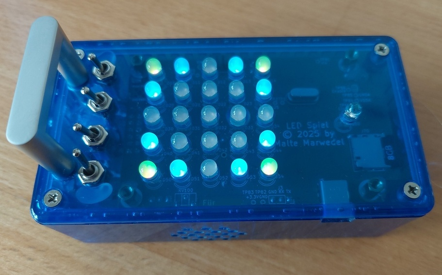
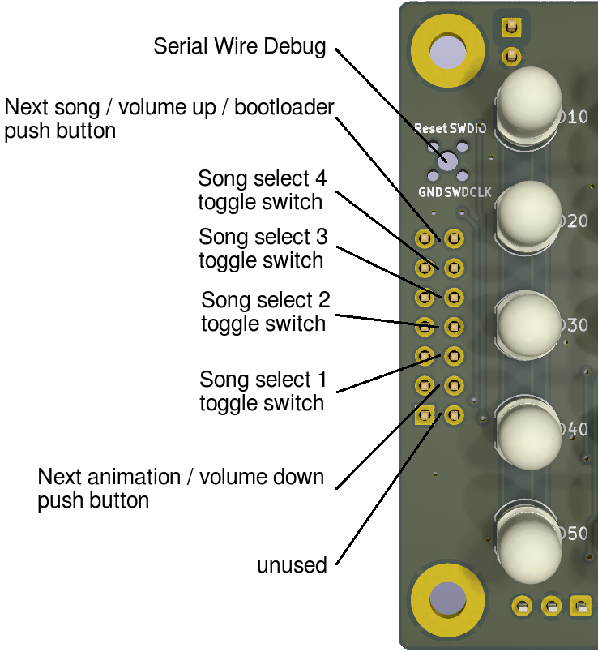
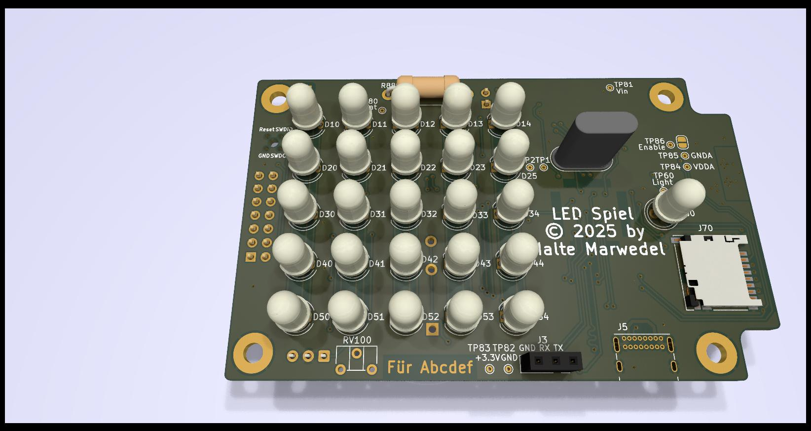
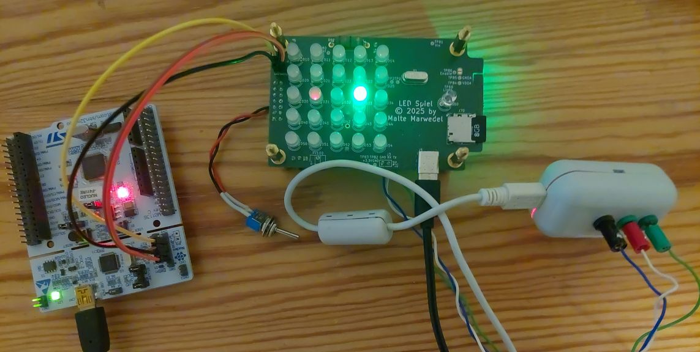

# LED Spiel

## Idea

Add some RGB LEDs in a box with sound. Fun for kids.



## Features

- 5x5 RGB LEDs

- Mono sound output

- Up to 7 inputs for buttons

- Measure brightness of environment to adjust LED brigtness

- IR receiver allows every remote control to become an extra toy

- Runs with two rechargeable NIMH AAA batteries. Non rechargeable ones work too.

- Slow charge over USB (~80mA). Can be disabled for non rechargeable batteries.

- SD card for storing sound (mp3 files) and LED sequences

- SD card file exchange and firmware upload over USB

- The STM32F405 MCU is fast enough for mp3 decoding

- Costs for all parts is ~95€.

## Status

The PCB is soldered, the case is complete, the software for the toy works, but is incomplete.

Two push buttons are on the left side, if one is pressed during power up, the device enters DFU firmware download mode.

Four switches are there for selecting songs.

Some animations are available.

Missing featues:

- Data exchange over USB mass storage is slow

- The IR receiver is currently unused.

## Usage

By default the combination of the four switches select the folder to play a song and animation from.

Then one push button selects the next song within the folder and the other push button the next animation.

Pressing the upper push button for three seconds stops the audio playback.

Pressing both push buttons at the same time for three seconds starts the USB mode, another press for three seconds stops the mode again.

Pressing the upper push button while powering on starts the internal bootloader for firmware updates

By default the playback stops after 5 songs without any user input.
The folders on the SD card need to be named 01 02 ... 16.
The files in each folder can have any name, they are sorted alphabetically based on the first three letters.
So the names should be unique within the first three letters.

Charging starts automatically when USB is connected and stops after 14 hours, then its disabled for at least one hour.
Charging is very slow, so without any control over the battery state, there is no problematic overcharging.

The pin connection of the inputs is the following:




### Simplified mode

By creating a configuration file /etc/ledspiel.conf on the SD card, the behaviour of the buttons can be changed:

```json
{
   "mode": "simple",
   "pushvolume": "true",
   "volume": "5"
}
```

If mode is simple, the four switches select the first four animation + mp3 files in folder 01.
The switch position does not matter, only which switch was changed last does.
Also each file is simply repeated until another one is selected.

If pushvolume is true, each of the push buttons control volume up and volume down instead of selecting another animation or mp3.
Note: The control of the volume is digital and since the the DAC has a limited range, playing lower volumes results in less quality.

volume will be the default volume after startup, the supported range is 1 ... 5.

5: 100%, 10bit DAC resolution

4: 50%, 9bit DAC resolution

3: 25%, 8bit DAC resolution

2: 12.5%, 7bit DAC resolution

1: 6.25%, 6bit DAC resolution

## History

Planning...



Soldering and debugging...


